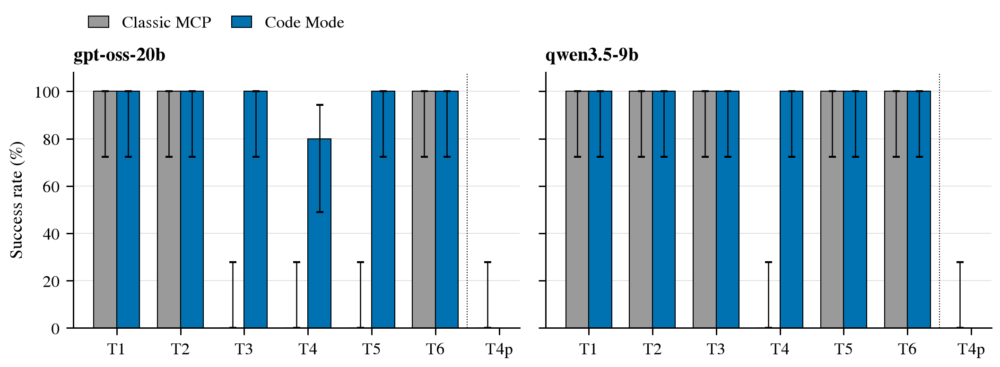
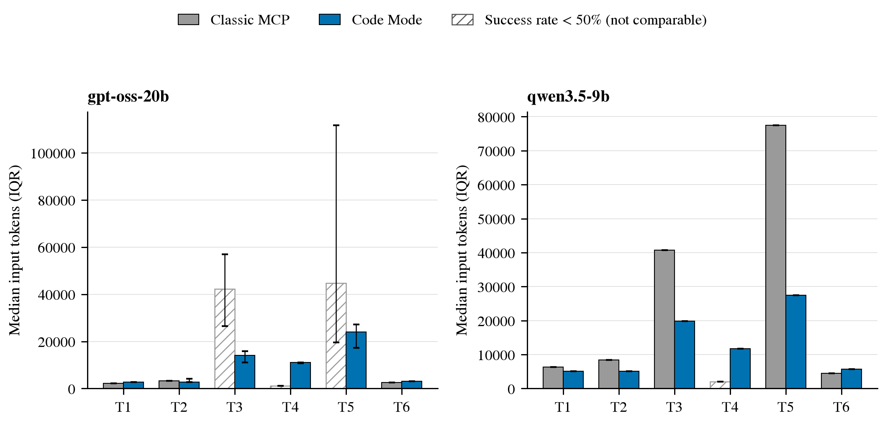

# code-mode-bench

### Code Mode vs classic MCP tool-calling, measured on local LLMs


## TL;DR

**Question:** does "Code Mode" (the model writes a script against a typed API instead of
calling MCP tools one at a time) actually help, on real local models, on a real 24 GB GPU --
or is it just a token-efficiency trick that doesn't matter in practice?

**Three results, from 280 real trials on 2 models:**

1. **It's not just about tokens -- it's about finishing the task at all.** On data-heavy tasks
   (large volumes, chained aggregation, loops with writes), classic MCP tool-calling hit the
   model's context limit and failed outright; Code Mode kept the bulk data out of the model's
   context and succeeded on the same tasks.
2. **Every single context-overflow failure (20/20) happened in classic mode, none in Code Mode** --
   on a small GPU, context is the resource that runs out first, and Code Mode is a direct answer
   to that specific constraint.
3. **The effect depends heavily on the model.** One model (gpt-oss-20b) went from 0% to 80-100%
   success on the hardest tasks with Code Mode; another (qwen3.5-9b) already handled them in
   classic mode and mainly gained token efficiency, not a success-rate rescue.

Full results, methodology, and the blog article once published: [`REPORT.md`](REPORT.md) *(blog
link to come once the article is live on
[samiraitabbou.hashnode.dev](https://samiraitabbou.hashnode.dev))*.

## Architecture

```
                    ┌─────────────────────────┐
                    │   configs/models.yaml   │
                    │ configs/experiment.yaml │
                    └────────────┬────────────┘
                                 │
                   ┌─────────────────────────┐
                   │   cmbench.runner        │  orchestration, resume,
                   │   (CLI: cmbench bench)  │  shuffled trial order
                   └────────────┬─────────────┘
                                 │  per trial
              ┌──────────────────┴──────────────────┐
              │                                       │
     ┌────────▼────────┐                   ┌─────────▼─────────┐
     │  modes/classic   │                   │  modes/codemode    │
     │  tool-call loop  │                   │  typed_api.py +     │
     │  (<=15 turns)    │                   │  execute_python()   │
     └────────┬────────┘                   └─────────┬───────────┘
              │                                        │
              │  MCP tool calls              ┌─────────▼─────────┐
              │                               │  sandbox/runner    │
              │                               │  (isolated subproc,│
              │                               │   no network)       │
              │                               └─────────┬───────────┘
              │                                          │ JSON-RPC bridge
              └──────────────────┬───────────────────────┘
                                   │
                        ┌──────────▼──────────┐
                        │  mcp_server (12 or   │
                        │  60 tools) over the  │
                        │  reference SQLite DB │
                        └──────────┬───────────┘
                                    │
                         ┌──────────▼──────────┐
                         │ providers/openai_    │  vLLM, OpenAI-
                         │ compat -> vLLM       │  compatible API
                         └──────────────────────┘
```

Both modes share the *same* MCP tool schemas and the *same* reference database, so the
comparison is about how the model accesses the tools, not what the tools can do.

## Quickstart

```bash
uv sync --extra dev
uv run cmbench data          # generate the deterministic reference database
uv run pytest                # 98 tests, no GPU or API key needed (fake provider)

# Against a real vLLM server (see docs/REPRODUCE.md for the full setup):
bash scripts/serve_vllm.sh gpt-oss-20b
uv run cmbench smoke --model gpt-oss-20b
uv run cmbench run --model gpt-oss-20b --mode codemode --task T3 --reps 1
bash scripts/stop_vllm.sh
```

## Reproduce the full benchmark

Requires a GPU with ~22+ GB free VRAM and a CUDA 12.8+-capable driver (see
[`docs/REPRODUCE.md`](docs/REPRODUCE.md) for the full requirements and setup). The full
280-trial series (2 models x 140 trials each, including the 60-tool variant) took ~4.9
GPU-hours of compute on a single L40S-24Q vGPU:

```bash
tmux new -s cmbench 'bash scripts/run_all.sh'   # unattended, resumable, survives SSH drops
uv run cmbench report                           # regenerate CSVs, figures, REPORT.md
```

## Results

| Hypothesis | Verdict |
|---|---|
| H1: Code Mode cuts input tokens on data-heavy tasks | **Confirmed** |
| H6: more tools => classic MCP pays more in tokens | **Confirmed** (+55% to +114%, 12->60 tools) |
| H7: Code Mode finishes tasks classic mode can't, for context reasons | **Confirmed** (20/20 context-overflow failures are classic-mode) |
| H5: the effect depends on the model | **Confirmed** |

Full table (all 6 tasks x 2 modes x 2 models x 2 tool-count variants) and all 7 hypotheses
(H1-H7) with evidence: [`REPORT.md`](REPORT.md) §4 and §6.



*Figure 4 (REPORT.md). Success rate per task and condition (n = 10 per bar; T4p = paginated variant, classic only). Error bars: 95% Wilson intervals.*



*Figure 2 (REPORT.md). Median input tokens per trial, with interquartile ranges. Hatched bars: cells where fewer than half of the trials succeeded (not comparable).*

All figures are in [`results/figures/`](results/figures/) (`01_...png` through `08_...png`), regenerated together with `uv run cmbench report` (the 6 required by `CLAUDE.md` §6) and `uv run python scripts/paper_figures.py` (adds the architecture diagram and the T4/T4p context-limit scatter). Both read from `cmbench.report.plots`, so there is a single figure style across the repository.

## Methodology, in brief

6 tasks (simple lookup -> chained aggregation -> large-volume filter -> loop with writes ->
free-form text) against a deterministic SQLite CRM, graded by SQL-computed expected answers,
10 repetitions per cell, Wilson 95% confidence intervals on success rates. Full detail,
including exactly how tokens/GPU-time/failure types are measured and classified:
[`docs/METHODOLOGY.md`](docs/METHODOLOGY.md).

## Extending

- **Add a model**: add an entry to `configs/models.yaml` (HF repo, quantization, vLLM
  tool-call parser); `scripts/serve_vllm.sh` and `cmbench serve-cmd` read it automatically.
- **Add a task**: add an entry to `src/cmbench/tasks/tasks.yaml` plus its expected-answer
  query in `src/cmbench/tasks/graders.py`; both modes pick it up with no other changes, since
  the task statement and grading are mode-agnostic.
- **Add a mode**: implement the same interface as `src/cmbench/modes/classic.py` /
  `codemode.py` (a function taking a `TrialSpec`, a `Provider`, and the MCP tools, returning a
  `TrialRecord` + transcript); `runner.py` dispatches on `spec.mode`.
- **Add a provider**: implement `src/cmbench/providers/base.py`'s `Provider` interface (see
  `openai_compat.py` for the only current implementation, against vLLM). The interface is
  provider-agnostic by design, so a cloud API could be added later without touching the modes
  or the runner -- not implemented here, since this project's scope is 100% local models.

## Limitations

- Small sample (10 repetitions/cell, 5 for the tool-bloat variant) on one synthetic database.
- Only 2 of the 4 originally planned models actually ran; two were dropped for hard
  dependency conflicts on the test VM's CUDA 12.8 driver (see `REPORT.md` §8).
- Cost is estimated local GPU-time, not real cloud/API pricing.
- One hardware profile (a single L40S-24Q vGPU slice, ~21.7 GB usable VRAM).

Full discussion: [`REPORT.md`](REPORT.md) §7.

## Citation

```bibtex
@misc{aitabbou2026codemodebench,
  author = {Ait-Abbou, Samir},
  title  = {code-mode-bench: Code Mode vs classic MCP tool-calling, measured on local LLMs},
  year   = {2026},
  url    = {https://github.com/samir-aitabbou/code-mode-bench}
}
```

## License

[MIT](LICENSE) © 2026 Samir Ait-Abbou

## Author

**Samir Ait-Abbou** -- AI & ML Engineer
[LinkedIn](https://www.linkedin.com/in/samir-ait-abbou/) ·
[Blog](https://samiraitabbou.hashnode.dev) ·
[GitHub](https://github.com/samir-aitabbou)
